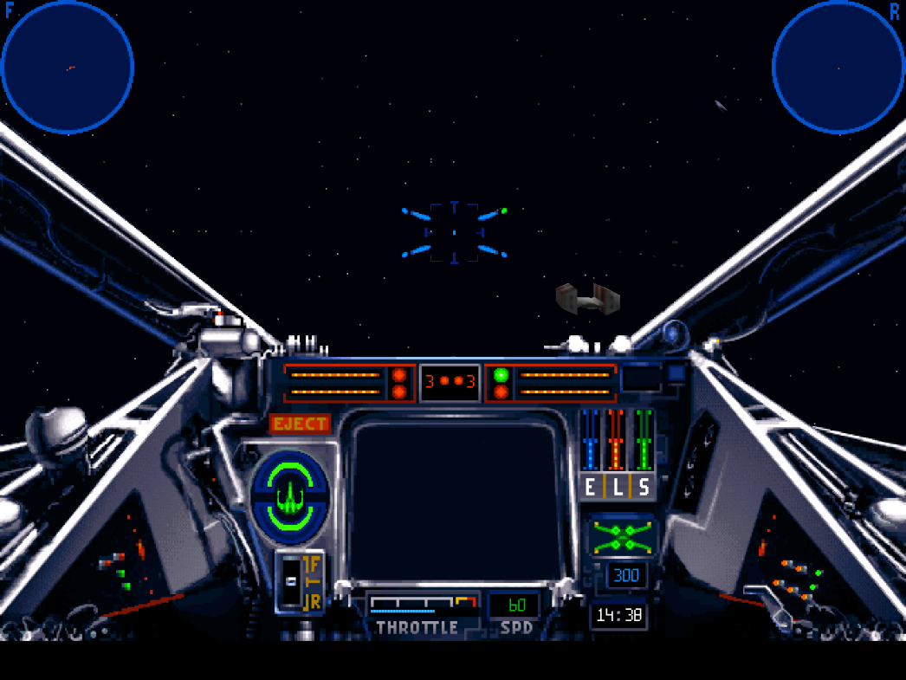
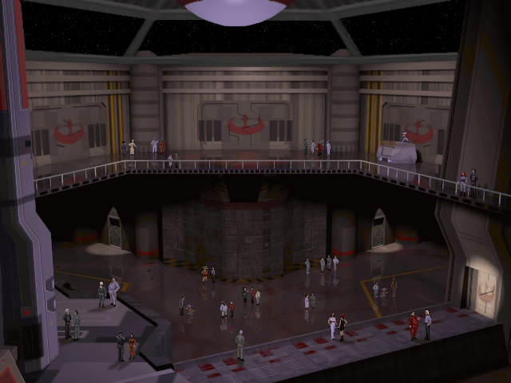
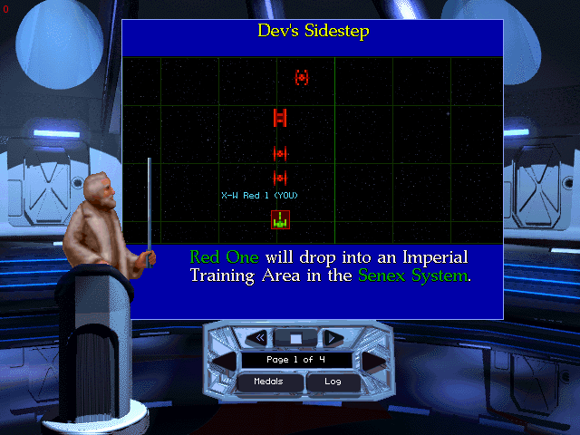
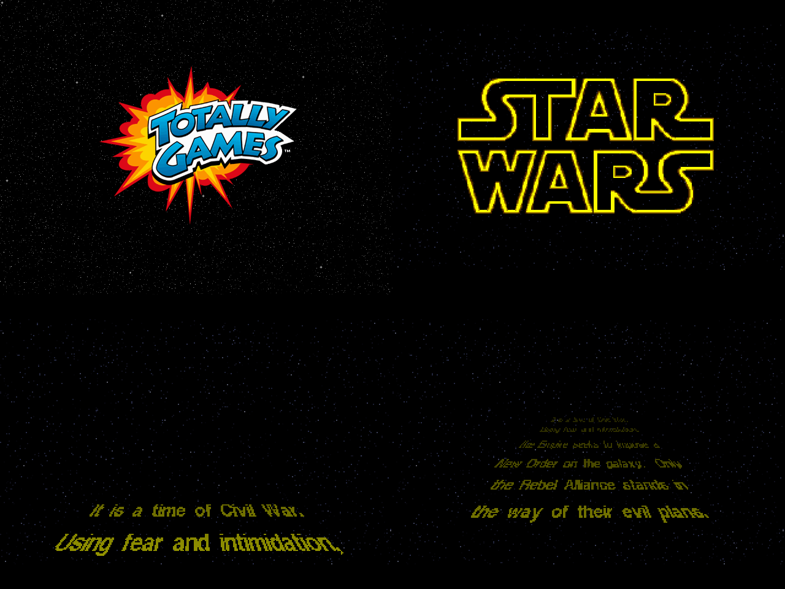
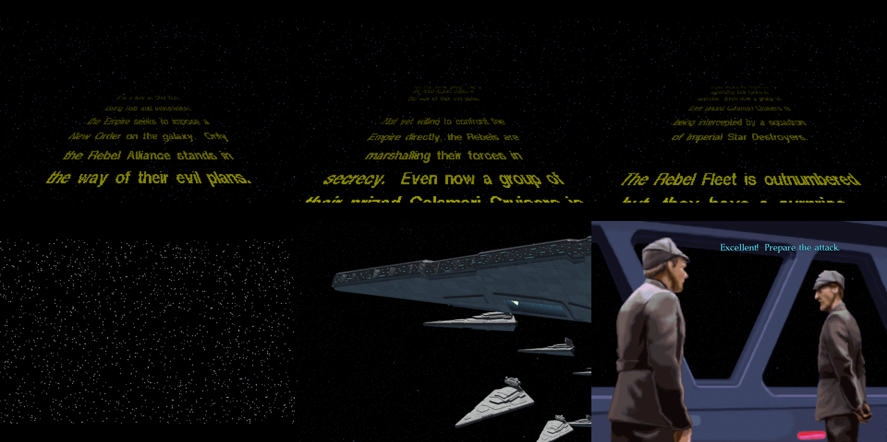
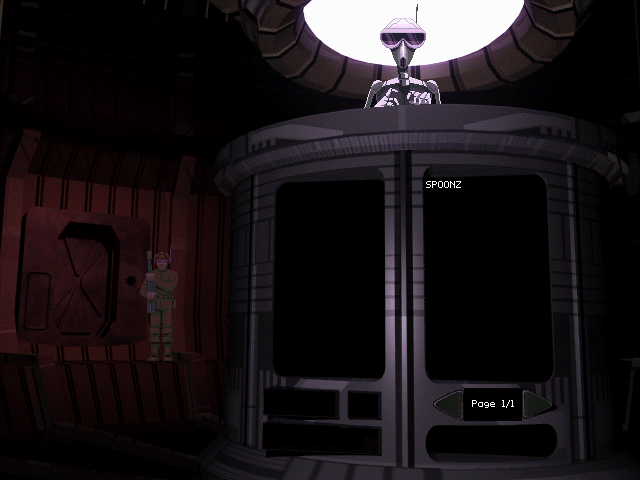

# X-Wing recomp

A static recompilation of **Star Wars: X-Wing** (the 1998 Windows 95 edition,
as sold on Steam) to a native 32-bit Windows program. The game's x86 code is
lifted to C by pcrecomp and runs on its native32 runtime, with a remaster
on top: its own Direct3D 11 window, the 3D drawn at your screen's
resolution, HD texture packs, mod files, and flying with a pad or the mouse.

You supply your own copy of the game. Nothing from it is in this repo.

## Status

**Alpha.** Flies. Boots, plays the whole intro, registers a pilot, walks the
concourse (tech room, film room, historical combat), plays the briefing and
the launch cutscene, and flies Historical Combat mission 1 in the X-Wing
cockpit with its HUD and textured TIE fighters, the 3D at the window's
resolution. Keys, clicks and the virtual joystick work, from the player or
from a `--keys` script. Not yet checked: sound, firing, and whole missions.








## The remaster

All switchable in the settings menu (F10, or right-click beside the
picture), kept in `build\xwing.ini`:

| What | How |
|---|---|
| **Its own window** | Direct3D 11, resizable; F11 or Alt+Enter for borderless fullscreen. With no GPU (a VM, RDP) it falls back to WARP. |
| **Scaling** (F12) | sharp-bilinear (default), smooth, CRT (scanlines, aperture grille), nearest, integer, for the game's 640x480 art: menus, cutscenes, the cockpit. |
| **High-resolution 3D** | the game's "3D Hardware" mode hands Direct3D screen-space triangles; they are drawn at the window's resolution (1080p, 4K) with MSAA and bilinear or anisotropic filtering. The 2D drawn before the 3D (the stars) goes under it, the cockpit over it. On by default; `--software-3d` for the original renderer. |
| **HD textures** | each texture the game uploads is hashed, and `mods\textures\<hash>.png` (any size) is used in its place. `--dump-textures` (or the menu) writes the originals to `mods\dump\` to start from. |
| **Mod files** | a file under `mods\files\` replaces the game's file at the same path (ship models, resources, missions); the game's copy is not changed. |
| **Flying without a joystick** | an Xbox pad (left stick; right stick rudder; A or right trigger fires), the mouse in flight (distance from the centre steers, left button fires), or the arrow keys. A real joystick is used when one is plugged in. |

`mods\` is in the game folder. Not done yet (ROADMAP.md): widescreen, which
needs the flight engine's projection; and upgraded ship models from X-Wing vs.
TIE Fighter or XWA packs, which are newer OPT versions than the version 1
X-Wing reads and would need converting.

## Step by step

1. Copy the Steam folder `STAR WARS X-Wing/remastered` into `game/`.
2. The Steam executable is wrapped in SteamStub DRM. Unwrap your copy with
   [Steamless](https://github.com/atom0s/Steamless) and put the result at
   `work/xwing95.exe`:
   ```
   Steamless.CLI.exe game\XWING95.EXE
   copy game\XWING95.EXE.unpacked.exe work\xwing95.exe
   ```
3. Catalogue and lift it:
   ```
   py -3 ..\pcrecomp\tools\disasm\disasm32.py work\xwing95.exe -o work\functions.json
   py -3 run_lift.py --all
   ```
4. Build: `build.cmd` (Visual Studio 2022, x86 tools).
5. Run: `build\xwingrecomp.exe --run`

## How it differs from the original

| What | Why |
|---|---|
| DirectDraw is softdd (`src/runtime/softdd.c`) | the game sets an 8-bit fullscreen mode; softdd draws it in a window |
| A virtual joystick when none is plugged in | the game refuses to start without one |
| DirectInput devices are background, non-exclusive | Acquire fails otherwise while another window is in front |
| The 3D texture mapper's self-modified fields are read at run time | it writes texture addresses into its own instructions (`code_patches` in `run_lift.py`, 408 fields) |
| Vertical blank follows a 60 Hz clock | the game waits for the blank to start and end |

## Test switches

`N:stick:X:Y` (-100..100) and `N:fire` / `N:nofire` work the virtual joystick.
`--keys "on:lgmusic.lfd,1:space,..."` sends keys (esc, enter, space, arrows,
letters, f1-f10) and clicks (`click:X:Y`, `move:X:Y`, game pixels) at the given seconds,
`on:NAME` waits until the game opens a file with NAME in it (a screen's
resources) and later times count from there, `N:shot=file.bmp` takes a
screenshot. While a script runs
the real keyboard and mouse are ignored. `--watchdog S` ends the run after S seconds and answers message boxes itself.
`--shot S file.bmp` writes the frame presented after S seconds (only the
game's own frame buffer, never the screen). `--sound` unmutes.
